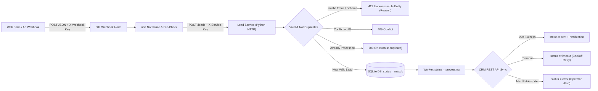

# System Architecture (`ARCHITECTURE.md`)
## Automated Lead Management System

---

## 1. High-Level Architecture Diagram

## 2. Component Breakdown

### 2.1. n8n Workflow (`workflows/lead-management.json`)
- **Lead Webhook (`n8n-nodes-base.webhook`):** Accepts `POST /webhook/lead-intake` protected by Header Auth (`X-Webhook-Key`).
- **Forward to Lead Service (`n8n-nodes-base.httpRequest`):** Forwards the raw payload to `http://127.0.0.1:8788/leads` (or `http://lead-service:8788/leads` in Docker) using `X-Service-Key` Header Auth, with `neverError: true` and `fullResponse: true` so HTTP status codes (`202`, `200`, `409`, `422`) are preserved.
- **Return Webhook Response (`n8n-nodes-base.respondToWebhook`):** Immediately returns the structured JSON status and HTTP status code to the caller.

### 2.2. Lead Processor & Storage Service (`src/lead_service.py`)
Written in standard-library Python 3.12+ for zero external runtime fragility:
1. **Input Normalizer (`normalize_lead`):**
   - Strips control characters and trims whitespace.
   - Collapses internal whitespace in `name`.
   - Converts `email` to lowercase.
   - Normalizes `phone` to E.164-like digits (`+` and digits only).
   - Defaults `source` to `"web_form"` if omitted.
2. **Validator (`validate_lead`):**
   - Validates `lead_id` (`[A-Za-z0-9_-]{1,80}`).
   - Validates `name` (2–120 printable characters).
   - Validates `email` format and checks against known invalid/disposable domains (`invalid.test`, `mailinator.com`, `tempmail.com`). Returns explicit machine-readable error codes (`invalid_email_format`, `disposable_email_domain`, `invalid_lead_id`, `invalid_name`).
3. **Idempotency & Deduplication Engine (`SQLite`):**
   - Computes a canonical SHA-256 HMAC fingerprint of `(lead_id, name, email, phone, source)`.
   - **Case 1 (Exact Repeat by `lead_id`):** Returns `200 OK` with `{"status": "duplicate", "dedup_by": "lead_id"}`.
   - **Case 2 (Mutated Payload on Same `lead_id`):** Returns `409 Conflict` with `{"error": "lead_id_conflict"}`.
   - **Case 3 (Different `lead_id`, Same Normalized `email` already synced/queued):** Returns `200 OK` with `{"status": "duplicate", "dedup_by": "email", "existing_lead_id": "..."}` so no duplicate CRM record is created.
4. **Stateful Worker & CRM Sync (`process_pending`):**
   - Transitions lead from `masuk` → `processing`.
   - Calls CRM REST API with `Idempotency-Key: lead-<lead_id>`.
   - Handles simulated or real timeouts (`status = timeout` with exponential backoff) and upstream API failures (`status = error` after max attempts or fatal 4xx).
   - Records operator notifications (`sent_confirmation` or `error_alert`) in the `notifications` table.

## 3. Database Schema (`leads.sqlite3`)

- **`leads` table:**
  - `lead_id` (`TEXT PRIMARY KEY`)
  - `name` (`TEXT NOT NULL`)
  - `email` (`TEXT NOT NULL`)
  - `phone` (`TEXT NOT NULL`)
  - `source` (`TEXT NOT NULL`)
  - `company` (`TEXT NOT NULL`)
  - `notes` (`TEXT NOT NULL`)
  - `fingerprint` (`TEXT NOT NULL`)
  - `status` (`TEXT NOT NULL` — `masuk`, `processing`, `timeout`, `sent`, `error`)
  - `crm_id` (`TEXT`)
  - `attempts` (`INTEGER NOT NULL DEFAULT 0`)
  - `next_retry_at` (`REAL NOT NULL DEFAULT 0`)
  - `last_error` (`TEXT`)
  - `created_at` (`REAL NOT NULL`)
  - `updated_at` (`REAL NOT NULL`)
- **`crm_demo` table:** Stores synced CRM records in local demo mode, enforcing uniqueness on `lead_id` and `email`.
- **`notifications` table:** Stores outbound alert/notification logs (`channel`, `lead_ ref`, `severity`, `summary`).
- **`audit_log` table:** Stores privacy-safe HMAC reference hashes (`ref`, `event`, `timestamp`) with zero PII.
