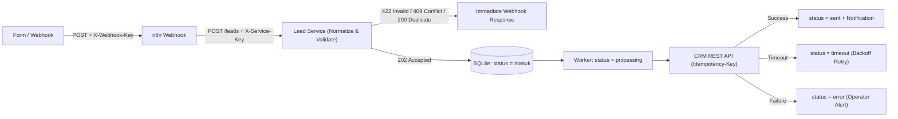

# Automated Lead Management System (n8n + REST API Companion)

> **Portfolio Project — Verified Lead Intake, Normalization, Deduplication & Stateful CRM Sync.**
> Built according to the AI-Assisted Production & Layered QA Standard. Runs offline in demo mode with zero external account dependencies.

---

## 1. Problem & Solution

**Problem:** Web forms and ad webhooks frequently deliver unformatted contact data, invalid or disposable emails, duplicate submissions when users double-click, and lost leads when a downstream CRM API times out.

**Solution:** This project combines an **n8n webhook workflow** (`workflows/lead-management.json`) with a zero-dependency **Python REST API & SQLite persistence service** (`src/lead_service.py`) that enforces:
1. **Data Normalization:** Trims whitespace, collapses spaces in names, lowercases emails, and normalizes phone numbers (`08...` → `+628...`).
2. **Email & Schema Validation:** Rejects malformed emails, control characters, and disposable domains (`mailinator.com`, `tempmail.com`, etc.) with HTTP `422` and a clear reason.
3. **Idempotency & Deduplication:**
   - Repeat submission with the same `lead_id` and payload returns `200 OK` (`status: duplicate`).
   - Modified payload on an existing `lead_id` returns `409 Conflict` (`lead_id_conflict`).
   - Repeat submission with an already-active normalized `email` under a new `lead_id` returns `200 OK` (`dedup_by: email`) without creating duplicate CRM records.
4. **Lifecycle State Tracking:** Tracks every lead through `masuk` → `processing` → `timeout` / `sent` / `error` with deterministic `Idempotency-Key` headers and operator notifications.

---

## 2. Quick Start (Run Demo & Tests Locally)

Requires **Python 3.12+** (no third-party pip packages required):

```powershell
# Run all positive, negative, and regression tests (9 tests)
python -m unittest tests/positive-tests/test_positive.py tests/negative-tests/test_negative.py tests/regression-tests/test_regression.py -v

# Run end-to-end simulation and inspect demo-result.json
python run_demo.py
```

---

## 3. Architecture



---

## 4. Repository Structure

```text
README.md
PRD.md
ARCHITECTURE.md
TEST_PLAN.md
SECURITY_REVIEW.md
FINAL_QA_REPORT.md
DEPLOYMENT.md
CHANGELOG.md
run_demo.py
demo-result.json
src/lead_service.py
workflows/lead-management.json
tests/positive-tests/test_positive.py
tests/negative-tests/test_negative.py
tests/regression-tests/test_regression.py
docs/screenshots/
```
